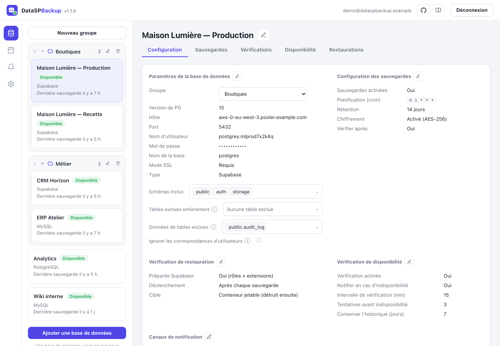
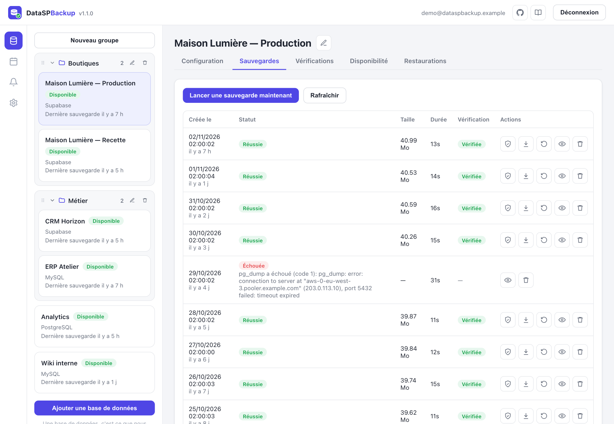
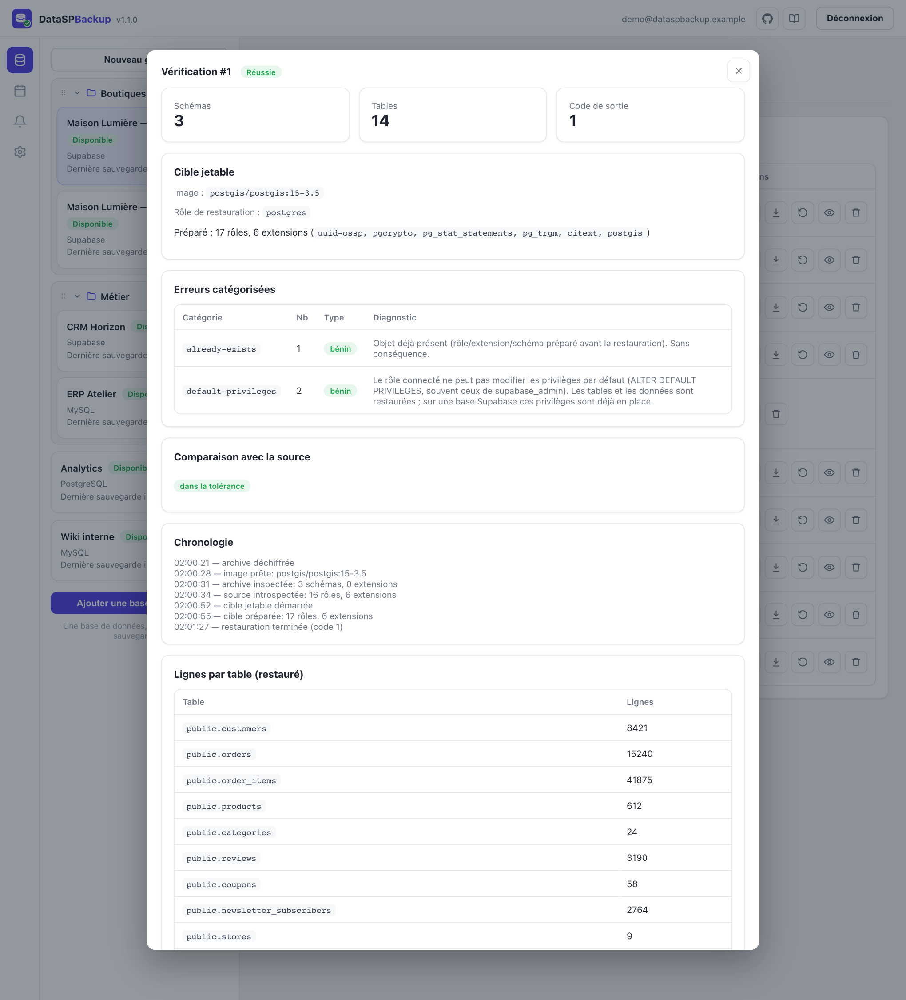
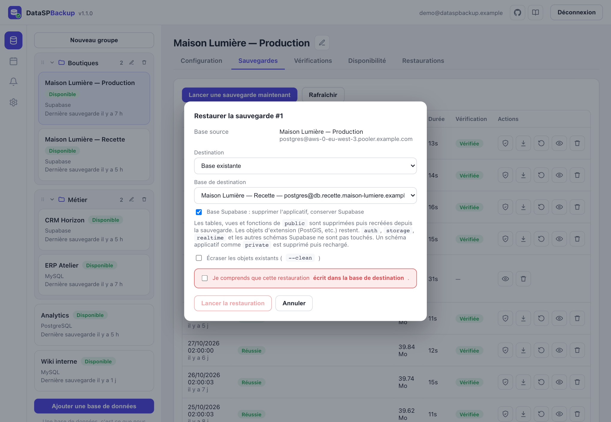
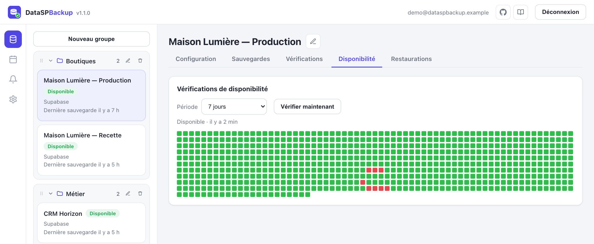
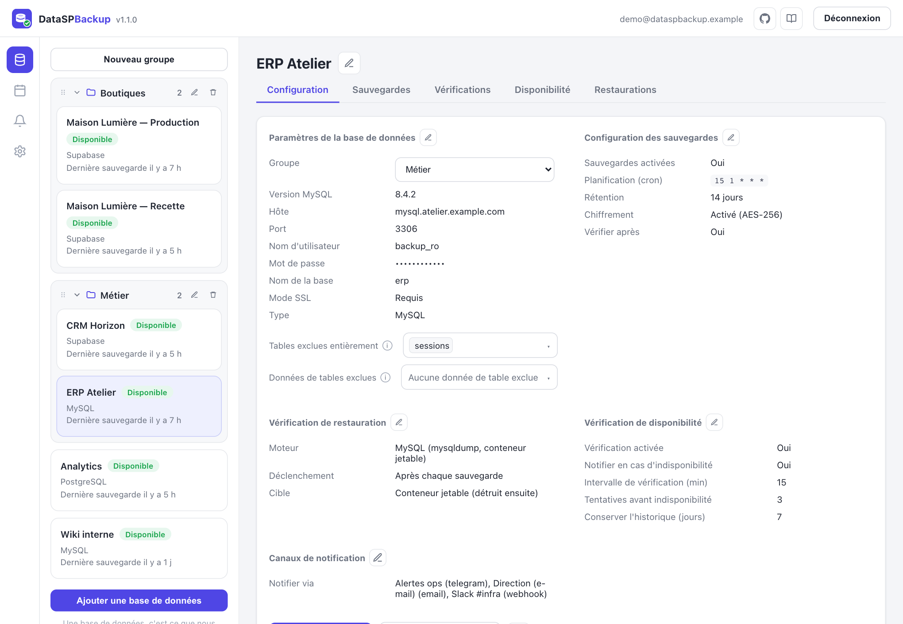
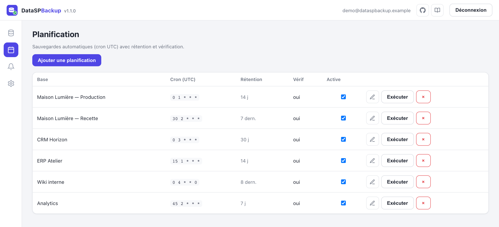
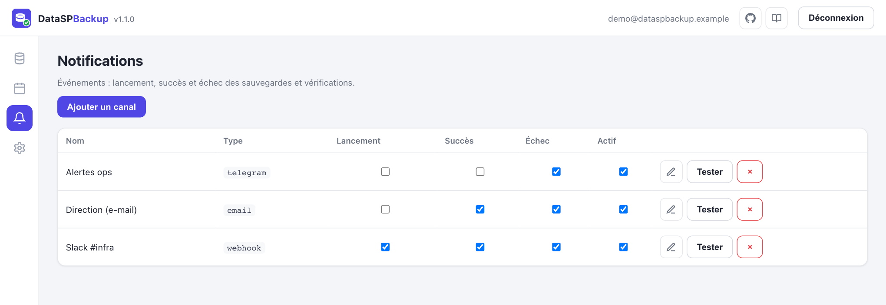
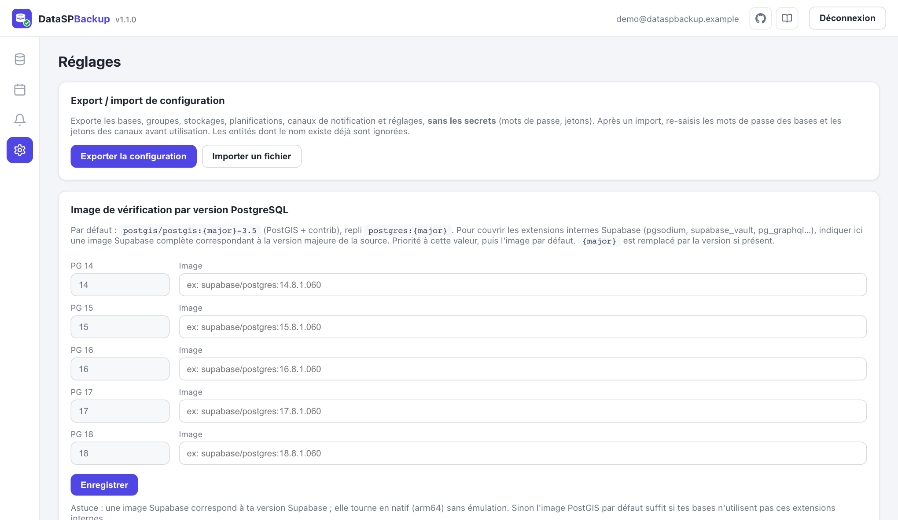

<p align="center">
  
</p>

<h1 align="center">DataSPBackup</h1>

<p align="center">
  Sauvegarde auto-hébergée de bases <strong>PostgreSQL / Supabase</strong> et <strong>MySQL / MariaDB</strong>,<br>
  avec <strong>vérification de restauration automatique</strong> dans un conteneur jetable.
</p>



<sub>Toutes les captures de ce document ont été réalisées avec des données fictives.</sub>

DataSPBackup planifie des sauvegardes chiffrées, **prouve qu'elles sont restaurables** (restauration dans un conteneur jetable, comparaison des lignes avec la source, rapport détaillé) et sait les restaurer vers une base existante ou une nouvelle base. Il a été pensé pour les bases **Supabase**, qu'un PostgreSQL vierge ne sait pas restaurer.

> Licence [Apache-2.0](LICENSE) · © 2026 Burotica. Projet écrit à partir d'un cahier des charges, sans reprise de code de Databasus / Databasement / Portabase.

**Sommaire** : [Fonctionnalités](#fonctionnalités) · [Aperçu](#aperçu) · [Pourquoi une vérification pour Supabase](#pourquoi-une-vérification-pour-supabase) · [Déploiement](#déploiement-docker) · [Premiers pas](#premiers-pas) · [Fonctionnement d'une vérification](#fonctionnement-dune-vérification) · [Sécurité](#sécurité) · [Architecture](#architecture) · [Développement](#développement) · [État et limites](#état-et-limites)

## Fonctionnalités

### Moteurs pris en charge

| Moteur | Sauvegarde | Vérification et restauration |
|---|---|---|
| **PostgreSQL / Supabase** | `pg_dump -Fc` exécuté dans un conteneur de la **même version majeure** que le serveur | PostgreSQL jetable **préparé pour Supabase** (rôles, schéma `extensions`, extensions détectées) |
| **MySQL / MariaDB** | `mysqldump` (tables, routines, triggers ; clauses `DEFINER` retirées) dans un client de la **même série** que le serveur | MySQL ou MariaDB jetable de la même série |

### Organisation en groupes

La liste des bases s'organise en **groupes** (dossiers) : « Nouveau groupe », renommage, suppression (les bases sont conservées), ordre des groupes modifiable et **glisser-déposer** des bases d'un groupe à l'autre. Le groupe d'une base se change aussi depuis ses paramètres.

### Sauvegardes

- Lancement manuel ou **planifié** : toutes les heures, tous les jours, toutes les semaines, tous les mois ou expression **cron** personnalisée (heure UTC).
- **Rétention** par période (N derniers jours), par nombre (N dernières sauvegardes) ou illimitée. La purge s'applique après chaque sauvegarde réussie.
- **Chiffrement AES-256-GCM** des archives, réglable par planification.
- **Filtres** de dump : schémas inclus, tables exclues entièrement, données de tables exclues, et pour PostgreSQL l'option « Ignorer les correspondances d'utilisateurs ». Pour MySQL : tables exclues et données exclues.
- **Téléchargement** de l'archive (déchiffrée à la volée) et **suppression** d'une sauvegarde (ses vérifications sont supprimées avec elle).

### Vérification de restauration

Après chaque sauvegarde ou à la demande, l'archive est restaurée dans un **conteneur jetable**, puis comparée à la source. Le rapport indique :

- le **statut**, décidé par les erreurs **bloquantes** et non par le code de sortie de `pg_restore` (qui vaut 1 dès qu'une erreur bénigne apparaît) ;
- l'**erreur d'origine** et les erreurs **catégorisées** (bloquantes ou bénignes) avec un diagnostic en clair ;
- le **nombre de lignes par table** et la **comparaison avec la source**, avec une tolérance pour une source qui continue d'évoluer (le plus grand de 100 lignes ou 10 %) ;
- la **chronologie** de l'opération et l'image utilisée.

### Restauration

Une sauvegarde se restaure vers une **base existante** ou une **nouvelle base** (créée automatiquement). Pour PostgreSQL :

- préparation Supabase optionnelle (rôles et extensions) pour une nouvelle base ;
- option « Base Supabase : supprimer l'applicatif, conserver Supabase » : les objets applicatifs (`public`, schémas applicatifs) sont remplacés sans toucher aux schémas Supabase (`auth`, `storage`, `realtime`…) ni aux extensions ;
- option « Écraser les objets existants » (`--clean`).

Une **confirmation explicite** est exigée avant toute écriture, et chaque restauration est suivie dans l'onglet *Restaurations*. La restauration MySQL refuse d'écrire dans la base source.

### Disponibilité

Surveillance périodique de chaque base : intervalle en minutes, nombre de tentatives avant de la déclarer indisponible, durée de conservation de l'historique. L'historique s'affiche en grille (aujourd'hui, 24 heures ou 7 jours), un bouton « Vérifier maintenant » lance un contrôle immédiat, et une alerte est envoyée quand une base devient indisponible.

### Notifications

Canaux **Telegram**, **e-mail (SMTP)** et **webhook**. Chaque canal choisit les événements qui le concernent (lancement, succès, échec) et dispose d'un bouton *Tester*. Chaque planification décide en plus si le succès et l'échec de ses sauvegardes sont notifiés. Des popups confirment aussi les opérations dans l'interface.

### Réglages et interface

- **Export / import de la configuration** (bases, groupes, stockages, planifications, canaux, réglages) au format JSON, **sans aucun secret**.
- **Image de vérification par version majeure** de PostgreSQL, pour couvrir les extensions internes de Supabase.
- Interface en thème clair, utilisable sur mobile, avec les liens vers le dépôt GitHub et vers cette documentation dans la barre du haut.

## Aperçu

### Sauvegardes d'une base

Statut, taille, durée et résultat de la vérification de chaque sauvegarde. Les actions (vérifier, télécharger, restaurer, détail, supprimer) tiennent sur une ligne.



### Rapport de vérification

Ici, `pg_restore` sort avec le code 1, mais les deux erreurs sont classées **bénignes** : la vérification est réussie, et la source concorde avec la copie restaurée.



### Restauration vers une base de destination



### Disponibilité



### MySQL / MariaDB



### Planification



### Notifications



### Réglages



## Pourquoi une vérification pour Supabase

Un PostgreSQL vierge ne suffit pas à restaurer une base Supabase : rôles manquants (`anon`, `authenticated`, `service_role`…), schémas `auth` / `storage` / `private`, extensions (PostGIS, `uuid-ossp`…), conflit `DROP SCHEMA public` avec PostGIS… DataSPBackup **prépare la cible avant la restauration**, distingue les erreurs **bloquantes** des erreurs **bénignes** (au lieu de tout marquer en échec sur le code de sortie 1 de `pg_restore`) et remonte l'**erreur d'origine** plutôt que la seule fin du flux.

## Déploiement (Docker)

Prérequis : Docker, avec un accès réseau du serveur aux bases à sauvegarder. Les clients `pg_dump`, `pg_restore`, `psql`, `mysqldump` et `mysql` ne sont pas embarqués dans l'image : ils tournent dans des conteneurs versionnés pilotés via le socket Docker, ce qui évite tout problème d'appariement de version et garde l'image légère.

```bash
cp .env.example .env
# Générer les secrets :
echo "MASTER_KEY=$(openssl rand -hex 32)" >> .env
echo "JWT_SECRET=$(openssl rand -hex 32)" >> .env
# Définir ADMIN_PASSWORD dans .env

docker compose up -d --build
```

L'interface est sur `http://localhost:4005`. Connexion avec `ADMIN_EMAIL` / `ADMIN_PASSWORD` (le compte est créé au premier démarrage, quand aucun utilisateur n'existe).

> ⚠️ **Conservez `MASTER_KEY` à part des sauvegardes.** Elle chiffre les archives et les mots de passe stockés : sans elle, les archives chiffrées et les secrets enregistrés sont illisibles.

### Variables d'environnement

| Variable | Défaut | Rôle |
|---|---|---|
| `MASTER_KEY` | **obligatoire** | Clé de chiffrement (32 octets en hexadécimal, `openssl rand -hex 32`) |
| `JWT_SECRET` | **obligatoire** | Secret de signature des sessions |
| `ADMIN_EMAIL`, `ADMIN_PASSWORD` | `admin@example.com`, vide | Compte propriétaire créé au premier démarrage |
| `PORT`, `HOST` | `4005`, `0.0.0.0` | Adresse d'écoute |
| `DATA_DIR` | `/data` | Métadonnées SQLite et archives |
| `DOCKER_SOCKET` | `/var/run/docker.sock` | Socket du démon Docker |
| `VERIFY_DATA_VOLUME` | vide | Nom du volume de données vu par le démon Docker (voir ci-dessous) |
| `VERIFY_PG_IMAGE` | `postgis/postgis:{major}-3.5` | Image du PostgreSQL jetable (`{major}` = version majeure détectée) |
| `VERIFY_PG_IMAGE_FALLBACK` | `postgres:{major}` | Repli si l'image précédente est indisponible (sans PostGIS) |
| `VERIFY_PG_IMAGE_MAP` | vide | Image prioritaire par version majeure, en JSON (modifiable aussi dans *Réglages*) |
| `LOG_LEVEL` | `info` | `debug`, `info`, `warn` ou `error` |
| `DEV_ALLOW_EPHEMERAL_SECRETS` | vide | `1` : génère des secrets temporaires, **développement uniquement** |

Sans `MASTER_KEY` ni `JWT_SECRET`, le serveur refuse de démarrer : il n'existe aucun secret par défaut.

### Dokploy

Déployer par `docker-compose.yml`. Points d'attention :

- monter le socket Docker (`/var/run/docker.sock`), indispensable aux sauvegardes, aux vérifications et aux restaurations ;
- fournir `MASTER_KEY`, `JWT_SECRET` et `ADMIN_PASSWORD` ;
- `VERIFY_DATA_VOLUME` doit correspondre au **nom réel** du volume tel que vu par le démon Docker (les conteneurs jetables le montent pour lire les archives) ;
- placer l'application derrière un reverse proxy HTTPS : le cookie de session est marqué `Secure` en production.

## Premiers pas

1. Connectez-vous avec le compte d'administration.
2. **Bases** → *Ajouter une base de données* : choisissez PostgreSQL / Supabase ou MySQL, puis renseignez l'hôte, le port, l'utilisateur, le mot de passe et le mode SSL. Pour Supabase Cloud, utilisez l'hôte du *Session Pooler* (compatible IPv4).
3. *Tester la connexion* détecte la version du serveur.
4. Dans *Configuration des sauvegardes* (icône crayon), choisissez l'intervalle, l'heure, la rétention et les notifications. La page *Planification* (icône calendrier) regroupe toutes les planifications.
5. *Lancer une sauvegarde* : une vérification suit automatiquement si elle est activée. Consultez le résultat dans les onglets *Sauvegardes* et *Vérifications*.
6. **Alertes** : ajoutez un canal Telegram, e-mail ou webhook et testez-le.

## Fonctionnement d'une vérification

**PostgreSQL / Supabase**

1. L'archive est rendue lisible dans le volume de données (déchiffrée si besoin, puis supprimée en fin d'opération).
2. Choix de l'image du PostgreSQL jetable : l'image définie pour cette version majeure dans *Réglages*, sinon `postgis/postgis:<major>-3.5`, sinon `postgres:<major>`. Le serveur essaie d'abord l'architecture native, puis `linux/amd64` émulé.
3. Inspection de l'archive (`pg_restore -l`) et **introspection de la source en lecture seule** : les rôles et extensions réellement présents (un dump Supabase ne les contient pas).
4. Démarrage du conteneur jetable, en attendant le serveur définitif et non le serveur temporaire d'initialisation.
5. Base cible **vide** : pas de `--clean`, donc pas de `DROP SCHEMA public`.
6. **Préparation avant restauration** : rôles, schémas (`extensions`…), extensions et appartenances de rôles Supabase.
7. `pg_restore`, en continuant malgré les erreurs pour pouvoir les catégoriser.
8. Comptage des lignes par table dans la cible.
9. Comparaison avec la source, avec tolérance.
10. Rapport, puis destruction du conteneur. Le statut dépend des erreurs bloquantes et de la comparaison, pas du code de sortie.

**MySQL / MariaDB** : l'archive est déchiffrée, importée dans un conteneur MySQL ou MariaDB jetable de la même série que le serveur, les lignes sont comptées puis comparées à la source (lecture seule), et le conteneur est détruit.

## Sécurité

- **Aucun secret par défaut** : le serveur refuse de démarrer sans `MASTER_KEY` ni `JWT_SECRET`.
- Les **mots de passe des bases** et la configuration des canaux de notification (jetons, identifiants SMTP) sont **chiffrés** en AES-256-GCM avec `MASTER_KEY`, **jamais renvoyés** par l'API et **jamais journalisés** (masquage des champs sensibles dans les logs).
- Les **archives** sont chiffrées en AES-256-GCM (réglable par planification, activé par défaut).
- L'**export de configuration ne contient aucun secret** : après un import, les mots de passe des bases et les jetons des canaux sont à ressaisir (une alerte l'indique dans l'interface).
- La vérification restaure toujours dans un **conteneur jetable** et ne lit la source qu'en **lecture seule**.
- Toute restauration vers une base réelle exige une **confirmation explicite**.
- Un compte propriétaire unique ; session par cookie `HttpOnly` / `SameSite=Lax` (et `Secure` en production), valable 7 jours.
- ⚠️ Monter `/var/run/docker.sock` donne à l'application un contrôle étendu sur le démon Docker de l'hôte : limitez l'accès réseau à l'interface et exposez-la en HTTPS.

## Architecture

| Brique | Choix |
|---|---|
| Serveur + API | Node.js / TypeScript (Fastify) |
| Interface | Vue 3 + Vite + Pinia, servie en statique par le serveur |
| Métadonnées | SQLite, dans le volume de données |
| Outils de base de données | Clients PostgreSQL et MySQL exécutés dans des conteneurs versionnés, pilotés via l'API Docker |
| Exécution | Planificateur cron intégré et file d'attente : une tâche lourde (sauvegarde, vérification, restauration) à la fois |
| Chiffrement | AES-256-GCM (archives et secrets stockés) |

## Développement

Les modules natifs (`better-sqlite3`, `esbuild`) doivent pouvoir compiler : lancez `npm install` dans un terminal normal.

```bash
npm install
cp .env.example .env   # renseigner MASTER_KEY, JWT_SECRET, ADMIN_PASSWORD et DATA_DIR=./data
npm run dev:server     # API sur :4005 (le fichier .env est chargé automatiquement)
npm run dev:web        # interface sur :5173 (proxy /api -> :4005)
npm test               # tests unitaires du serveur (vitest)
npm run build          # build du serveur (tsc) et de l'interface (vite)
```

Pour un essai rapide sans `.env`, `DEV_ALLOW_EPHEMERAL_SECRETS=1 DATA_DIR=./data ADMIN_PASSWORD=dev` génère des secrets temporaires. Ils changent à chaque démarrage : les mots de passe et archives chiffrés par une exécution précédente ne sont alors plus lisibles.

Sur Apple Silicon, certaines images ne sont pas publiées en arm64 (c'est le cas de `postgis/postgis`) : le serveur retombe sur `linux/amd64` émulé, plus lent mais fonctionnel.

Organisation du dépôt : `server/` (API, moteurs de sauvegarde, de vérification et de restauration, planificateur), `web/` (interface), `docs/screenshots/` (captures de ce document).

## État et limites

- **Stockage local uniquement** : les archives sont écrites dans `DATA_DIR`. Les stockages distants (S3, Cloudflare R2, SFTP) ne sont pas encore implémentés.
- **Pas d'agent distant** : les opérations s'exécutent sur la machine qui héberge le serveur, via son démon Docker.
- Un seul **compte** propriétaire, sans gestion de rôles ni d'équipes.
- Sauvegardes **logiques** uniquement : pas de sauvegarde physique ni d'archivage WAL (restauration à un instant précis), pas de sauvegarde des fichiers du stockage Supabase ni du `.env` Supabase (le dump ne contient que les métadonnées des objets).
- Moteurs : PostgreSQL / Supabase et MySQL / MariaDB. MongoDB n'est pas pris en charge.
- Rétention par durée ou par nombre ; pas de rétention par paliers (GFS).
- L'image PostGIS par défaut ne contient pas les extensions internes de Supabase (`pgsodium`, `supabase_vault`, `pg_graphql`…) : si une base en dépend, indiquez une image Supabase pour la version concernée dans *Réglages*.
- Les sauvegardes, les vérifications et les restaurations nécessitent l'accès au démon Docker de la machine hôte.
